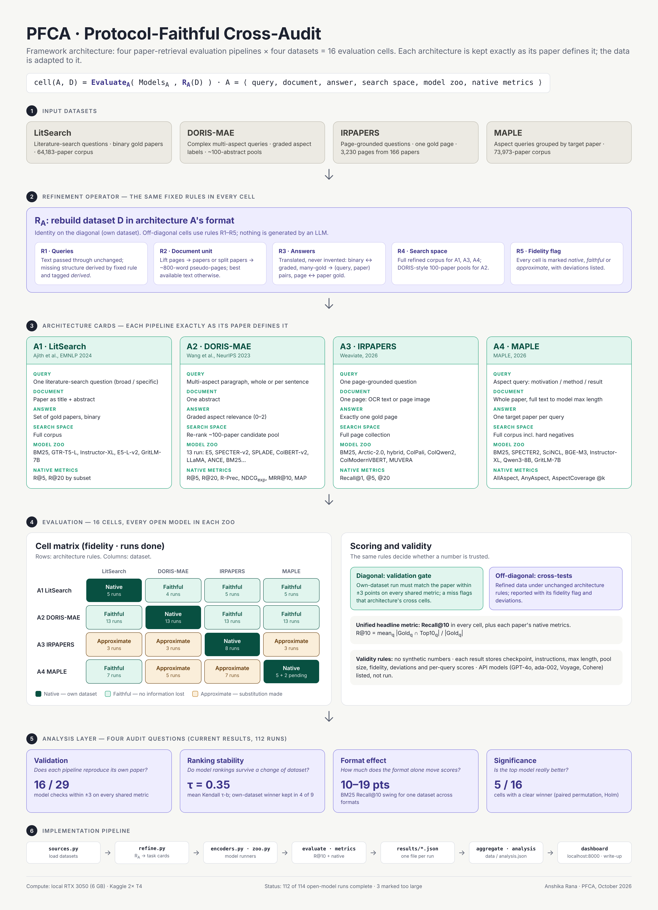

# PFCA: Protocol-Faithful Cross-Audit of scientific literature retrieval

Code for the paper *Framework for Audit of Information Retrieval Systems: A Protocol-Faithful Cross-Audit of Scientific Literature Search* (Anshika Rana and Rishabh Kaushal, IGDTUW).



## Repository layout

| Stage | Files |
|---|---|
| Downloading | `download_data.sh`, `download_data.py` |
| Refinement (R_A) | `xaudit/sources.py`, `xaudit/refine.py`, `xaudit/schema.py` |
| Evaluation | `xaudit/zoo.py`, `xaudit/encoders.py`, `xaudit/bm25.py`, `xaudit/evaluate.py`, `xaudit/metrics.py`, `xaudit/run.py` |
| Analysis and dashboard | `xaudit/aggregate.py`, `xaudit/analysis.py`, `serve.py`, `site/` |
| Large models on Kaggle | `kaggle/` |
| Results of the 112 runs | `results/*.json` (per-query scores included) |

---


Evaluates the **architectures of LitSearch, DORIS-MAE, IRPAPERS and MAPLE** on **all four
datasets**, giving **16 evaluations**. In each one, the dataset is rebuilt in the exact
query, document and answer format that the paper's architecture expects. Every model listed in each
paper is run (open models only), **Recall@10** is reported for all of them, and the paper's own
native metrics are reported alongside. The results appear on a **local website**.

- `FRAMEWORK.md`: the auditing framework (architecture cards, refinement rules, the 16-cell matrix).
- `serve.py`: the local results website at http://localhost:8000.

> `results/` contains the result files of the runs reported in the paper. Delete or move them to start from scratch; the website only shows result files that exist.

## 1. Setup (WSL2 Ubuntu, once)

```bash
cd ~/cross-audit/xaudit-kit            # wherever you put this folder (inside the Linux filesystem)
conda activate xaudit                   # the env from the setup guide
pip install torch torchvision --index-url https://download.pytorch.org/whl/cu124
pip install -r requirements.txt
bash download_data.sh                   # ~12 GB; resumes if interrupted
python tests/test_core.py               # quick self-check (no downloads)
```

## 2. Run

```bash
python -m xaudit.run --prepare                                # refine all 16 cells (no GPU needed)
python serve.py                                               # open http://localhost:8000 in a 2nd terminal
python -m xaudit.run --arch all --dataset all --model bm25    # fastest first results, all 16 cells
python -m xaudit.run --arch all --dataset all --tier local    # every model that fits a 6 GB GPU
```

Then run the 7–8B models on Kaggle (`kaggle/kaggle_run.md`) and copy their JSON files into `results/`.

Useful flags: `--arch A1|A2|A3|A4`, `--dataset litsearch|doris_mae|irpapers|maple`,
`--model <key>` (keys are in `xaudit/zoo.py`), `--batch-size 8` (if you run out of GPU memory),
`--max-len 2048` (e.g. BGE-M3 on 6 GB), `--max-pages-per-paper 30` (to shrink the A3 pseudo-page
cells), `--force` (re-run a model).

### Suggested order (most results per hour)
1. BM25 everywhere: minutes per cell, and it gives a first full 4×4 heatmap.
2. Diagonal cells with local models (`--dataset` set to each architecture's own dataset). These
   are the **validation gate**: they should land within ±3 points of the paper's numbers, which
   the website shows in grey next to yours.
3. The off-diagonal cells, smallest first: IRPAPERS, then LitSearch and MAPLE, then the 363K-abstract
   DORIS-MAE corpus under A1 and A4.

### Rough local cost on an RTX 3050 6 GB (estimates; your timings will vary)
| Cell type | Encoded text | Base-size model | Large model |
|---|---|---|---|
| A2 (pools) | ~10K abstracts | minutes | ~10–20 min |
| A1/A4 on LitSearch or MAPLE | 64–74K papers | ~20–40 min | 1–3 h |
| A1/A4 on DORIS-MAE | 363K abstracts | ~1–2 h | 4–8 h (overnight) |
| A3 on LitSearch/MAPLE pseudo-pages | ~0.5–1M pages | hours | use `--max-pages-per-paper` or Kaggle |

## 3. What runs where

| Status on the website | Meaning |
|---|---|
| **Done** | Real run, numbers from your machine or Kaggle. |
| **Pending** | Runnable; not run yet. |
| **Kaggle GPU** | 7–8B model: run on Kaggle (`kaggle/kaggle_run.md`). |
| **API · not run** | Paid API (GPT-4o rerankers, ada-002, Voyage, Cohere). Listed but not run (zero-cost configuration). |
| **External code** | Needs the authors' own code: RocketQA-v2 (PaddlePaddle), TSAspire / OTAspire (allenai/aspire), Qwen3-VL-Embed-8B / Ops-MM-Embed-7B (MAPLE screenshots). Run them with the paper's repo and add a result file (below). |
| **N/A** | Image model on a dataset with no page images. |

### Adding a result from external code
Save `results/<ARCH>__<dataset>__<model_key>.json`:
```json
{"arch": "A2", "dataset": "doris_mae", "model_key": "rocketqa-v2", "model_name": "RocketQA-v2",
 "status": "done", "recall@10": 31.2, "native": {"R@5": 15.6, "R@20": 45.4},
 "config": {"source": "DORIS-MAE repo, evaluation.py -o query"}}
```

## 4. Fidelity notes
- Diagonal cells use each paper's own data, format and metric definitions.
- Off-diagonal cells are labelled **faithful** or **approximate**. Every transformation is listed
  in the cell's detail view and in `results/tasks/*.json`.
- Checkpoints marked `*` on the website were not named in the paper, so the canonical public
  checkpoint was used: SimCSE, SPLADE-v2, SentBERT, LLAMA, ColPali, ColQwen2.
- Excluded: DORIS-MAE's in-domain fine-tuned variants (SPECTER-ID, SciBERT-ID). They need
  training, not evaluation.
- BM25 is a built-in Lucene-formula implementation (no Java). The tokenizer and stemmer used are
  recorded in each result.
- IRPAPERS used Weaviate (HNSW, ef=160). Here, search is exact, which can only match or beat HNSW.

## 5. Files
```
FRAMEWORK.md          auditing framework
xaudit/sources.py     load the 4 datasets in their native richness
xaudit/refine.py      R_A: rebuild a dataset in each architecture's query/document/answer format
xaudit/zoo.py         model zoos per paper, checkpoints, paper-reported numbers
xaudit/encoders.py    all model runners (BM25/TF-IDF, dense, SPLADE, ColBERT, ColPali family, MUVERA, fusion)
xaudit/evaluate.py    native metrics per architecture + unified Recall@10
xaudit/run.py         CLI
xaudit/aggregate.py   builds the website data from results/
serve.py, site/       local website
tests/                metric/fusion unit tests + synthetic end-to-end test (never shown as results)
kaggle/               how to run the 7–8B models
```
